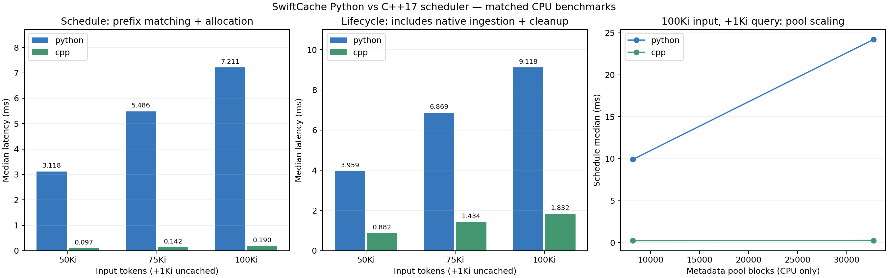

# SwiftCache C++ Scheduler 重构与性能对比

日期：2026-11-08。服务器：Cloud-A100-233；目录：`/root/hujianmin/SwiftCache`。
Python 基线：`fe7907086dfcdeabb8a1949c70b36eb0cd4ec3c6`，即上一轮已经优化过的 Python 调度器。
本次分支：`codex/cpp-scheduler`。

## 1. 交付与设计

调度数据路径已迁入 C++17：等待/运行队列、批预算、抢占、decode 调度、完成与取消、连续 token 存储、
逐块前缀哈希与内容核验、块分配/回收、引用计数及 free/owned/draining 状态。
Python 继续运行原来的扩缩容消息、确认/重放、需求窗口和 CUDA quiesce 协议，读取 C++ 的同一份元数据。
候选请求只在准入协调处进行每请求一次的 Python 调用，没有逐 token 或逐 block 的 Python 回调。

C++ 使用有序集合管理空闲候选，保留原有的 hash 有效性、hit_count、前缀距离、locality/ID 优先级，避免重建 Python 堆。
前缀仍做完整内容比较，哈希链仍与 Python 的 int64 字节表示、前缀 little-endian 字节一致。
本次是语言与数据结构的共同重构，不是仅替换字符串哈希函数，也不是算法复杂度变成只随新增 token 增长。
旧 `c_scheduler.cpython-310-*.so` 不参与本次实现。

token 列表只在入队时转换为连续 C++ 存储，转换使用检查过的 CPython list/int 读取；预留 decode 输出空间。
decode 过程中只有 block table 改变时才传回 Python，避免每个 token 重传 100K 上下文对应的约 400 个块号。
采样、top_p、stop、OpenAI 响应和模型计算仍共用上一轮实现。

## 2. 测试方法

- CPU：真实 Scheduler/BlockManager；预分词 token IDs；每请求的 Python 整数对象独立，避免对象复用使内容比较虚快。
- 主配置：池大小 512 blocks，每 block 256 token；各配置预热 100 次、测量 1000 次，重复 5 轮。
- 表中主值为“五轮各自 p50 的中位数”，p95 也采用各轮 p95 的中位数。原始样本与每轮分布保留。
- GPU/传输、JSON 解析、tokenizer 和输入 token 列表的预先构造不在 CPU 微基准范围。
- 同时记录完整调度生命周期：Sequence 构建 + 入队/原生转换 + schedule + postprocess + 请求对象释放。
- 上一个请求的释放原先可能发生在下一次 `seqs = schedule()` 赋值中；本次单独测量释放，两种后端都用修正后的同一驱动。
  初探数据单独归档，不混入下表，也不直接拿上一轮旧计时值计算加速比。
- 当前机器为共享服务器，双路 Xeon Gold 6230R，104 逻辑线程；OMP/OpenBLAS=4，未绑核或独占机器。
  Python 长尾波动明显，因此保留原始数据，不把少量样本的 p99 当作稳定结论。

## 3. 长前缀调度：前后对比

| 总输入 token | 命中 token | 实际新增 query | Python schedule p50 | C++ schedule p50 | 加速 | Python/C++ p95 |
| ---: | ---: | ---: | ---: | ---: | ---: | ---: |
| 51,200 | 50,176 | 1,024 | 3.118 ms | 0.097 ms | 32.09× | 7.279 / 0.135 ms |
| 76,800 | 75,776 | 1,024 | 5.486 ms | 0.142 ms | 38.66× | 9.664 / 0.192 ms |
| 102,400 | 101,376 | 1,024 | 7.211 ms | 0.190 ms | 38.04× | 14.746 / 0.258 ms |

100K 主场景的 schedule 中位耗时降低约 **97.4%**。这里测的是调度调用，不能将此加速比当作完整推理服务的加速比。

将转换、回收等成本都加回来：

| 输入 token | Python 生命周期 p50 | C++ 生命周期 p50 | 加速 | C++ 入队/转换 p50 | C++ 释放 p50 |
| ---: | ---: | ---: | ---: | ---: | ---: |
| 51,200 | 3.959 ms | 0.882 ms | 4.49× | 0.253 ms | 0.367 ms |
| 76,800 | 6.869 ms | 1.434 ms | 4.79× | 0.408 ms | 0.598 ms |
| 102,400 | 9.118 ms | 1.832 ms | 4.98× | 0.516 ms | 0.754 ms |

这张表包含 C++ 引入的边界转换，说明收益没有仅靠把工作移出 `schedule()` 计时获得。
生命周期 p50 来自逐请求总耗时分布；不以各阶段 p50 相加来替代总耗时 p50。

## 4. 批量请求与池规模

同样 100K/+1K，waiting 队列探测每配置预热 5 次、测量 20 次；这里只计首次调度调用。
两种实现的实际准入数量一致，其余请求会继续调度并检查引用不变量。

| waiting 请求数 | 首次实际 batch | Python p50 | C++ p50 |
| ---: | ---: | ---: | ---: |
| 1 | 1 | 6.644 ms | 0.270 ms |
| 2 | 2 | 13.733 ms | 0.373 ms |
| 4 | 4 | 28.607 ms | 0.912 ms |
| 8 | 8 | 58.329 ms | 1.845 ms |
| 32 | 8 | 83.307 ms | 1.850 ms |

这是共享活跃前缀的 CPU 调度实验，不能表述为 GPU batch=8 的吞吐；Native 入队转换不在首次调用列中。
100K/+1K 的大池测试（200 次×3 轮）：

| 元数据池规模 | Python p50 | C++ p50 |
| ---: | ---: | ---: |
| 8192 blocks | 9.911 ms | 0.228 ms |
| 32768 blocks | 24.210 ms | 0.255 ms |

这些池规模只在 CPU 构造元数据，没有分配相同规模的 GPU KV。
另有冷输入、部分命中、1/256/4096 新增长度、严格 50000/100000 输入和非块对齐测试，均保留实际命中数，不将目标“新增 1000”误报成真实 query 数。

## 5. Decode 调度

每请求从 102400 输入、101376 命中开始，输出 65 个 token；每配置预热 5 个批次、测量 20 个批次，
每批次记录后续 64 次 decode，共 1280 个调度调用。prefill 和输入转换不计入此独立指标。

| 活跃序列数 | Python schedule p50 | C++ schedule p50 |
| ---: | ---: | ---: |
| 1 | 3.529 μs | 2.606 μs |
| 2 | 4.063 μs | 3.500 μs |
| 4 | 6.462 μs | 5.290 μs |
| 8 | 10.283 μs | 8.857 μs |

decode 已处于微秒级，收益约 14%～26%，没有长前缀预填充调度那么大。
跨块时新分配块和回传 block table 的耗时单独保存在 `decode.json`；不能仅拿不跨块的中位数推断全部 decode 路径。

## 6. 正确性与运行范围

35 项自动测试通过，包含：Python/C++ 哈希逐字节一致、完整内容核验防止哈希碰撞误命中、
共享活跃前缀与缓存容量、300 步队列/抢占/decode/stop 差分、取消及对象释放、跨分配器计划隔离，
以及把原有扩缩容安全断言直接运行于 native 元数据上的测试。
其中包括 1000 次随机所有权交接、不重叠/不泄漏、活跃块 drain、重复确认、缩容前失效和非法边界拒绝。

真实 Qwen3-8B 单卡、本地限额 32 块回归：Python 和 C++ 各 11 组输出与已保存的基线逐 token 一致，
覆盖普通生成、前缀复用、256-token 跨块 decode、接近 8192 容量的输入；完成时引用为零。
这是有限容量的真实模型语义回归，并非 100K GPU 性能测试，也没有重新运行 HF 生成参考。

双卡 C++ 功能回归也已通过：GPU 0/1 各一个完整 Qwen3-8B、32 块限额缓存，
官方 SDK 同步/异步、中文流式/非流式、跨 chunk stop、多轮、usage、错误与取消，及 LangChain invoke/stream 全部通过。
实际运行 12 轮弹性并发交接，累计 56 次 resize_applied，包含 3 次活跃块回收；
worker 满容量 32 块时 master 排队后恢复，完成时无活跃引用、pending 或 draining。
8 个原有普通用例和 3 个边界用例均与已保存 HF 参考逐 token 一致。
完整状态保存在 [回归汇总](benchmarks/cpp-scheduler/validation-summary.json)。

GPU 0 恢复空闲后，另做了单卡、完整 Qwen3-8B、本地 KV 的 100K 实际引擎对照。
两个后端各三轮，每轮预热 10 次、测量 30 次，共 90 个样本；实际输入 102400、命中 101376、query=1024，输出 1 token。
每个样本检查命中数、query 数、有限 logits、远端加载为零和后端名称；90 组生成 token 在两个后端之间全部一致。
此组直接调用引擎，使用预构造 token IDs 和固定前缀列表，无 HTTP/JSON/全文分词，统计合并 90 个样本的 p50/p95。
它与独立整数对象的 CPU 主微基准不是同一计时路径，不直接拼接各阶段数据。

| 实际引擎指标 | Python p50 | C++ p50 | Python p95 | C++ p95 |
| --- | ---: | ---: | ---: | ---: |
| schedule | 5.426 ms | 0.419 ms | 9.206 ms | 0.771 ms |
| GPU model span | 489.330 ms | 490.847 ms | 491.637 ms | 539.453 ms |
| postprocess | 0.819 ms | 1.892 ms | 1.695 ms | 3.060 ms |
| 引擎请求总耗时 | 499.139 ms | 496.769 ms | 503.910 ms | 543.676 ms |

引擎总耗时中位数只降低约 **0.47%**，没有随 schedule 同比下降；C++ 的实际 postprocess 在这组环境中反而更慢。
C++ 首轮保留了 GPU span 的长尾样本（最大约 777 ms），总耗时均值为 505.746 ms，Python 为 499.356 ms；
这些样本没有被剔除。共享环境、顺序测试、GPU 时间跨度和 CPU 缓存条件的波动，使本次结果不能证明整体均值或 p95 已改善。
GPU model span 包含模型阶段的依赖与主机提交间隙，不是纯计算算子耗时。

两张卡的 100K 完整远端 KV 性能对照仍因另一张卡显存不足而未重跑。本报告不以此前的 GPU 数据推导新的远端/API 加速比。



## 7. 使用与复现

```bash
cd /root/hujianmin/SwiftCache
bash scripts/build_cpp_scheduler.sh
.venv/bin/python -m server.starter --config configs/two_qwen8b.yaml --scheduler-backend cpp
# Python 对照使用 --scheduler-backend python
```

CLI 为所有模型指定后端，YAML 可逐实例设置 `engine.scheduler_backend: cpp`。
默认仍可使用 Python；构建失败或 ABI 不匹配时显式报错，不静默降级。详细架构、限制和测试命令见 [C++ 接入说明](cpp-scheduler.md)。

CPU 核心复现：

```bash
export OMP_NUM_THREADS=4 OPENBLAS_NUM_THREADS=4
mkdir -p artifacts/cpp-scheduler/python-baseline
git archive fe79070 | tar -x -C artifacts/cpp-scheduler/python-baseline
.venv/bin/python tests/bench_scheduler.py --source artifacts/cpp-scheduler/python-baseline --backend python --suite core --output artifacts/cpp-scheduler/cpu-python-core.json
.venv/bin/python tests/bench_scheduler.py --source . --backend cpp --suite core --output artifacts/cpp-scheduler/cpu-cpp-core.json
.venv/bin/python tests/bench_decode_scheduler.py --output artifacts/cpp-scheduler/decode.json
.venv/bin/python -m pytest -q tests/test_elastic.py tests/test_serving.py tests/test_cpp_scheduler.py
```

原始数据、每轮日志、构建信息和模型回归在 `artifacts/cpp-scheduler/`；
小体积 [指标汇总](benchmarks/cpp-scheduler/metrics-summary.json) 和图保存在仓库。
完整数据另行打包，保留本次同口径 Python 基线，便于复核。

## 8. 结论

本次重构降低了长前缀匹配与分配的实际 CPU 成本。100K/+1K 场景中，schedule 从约 7.21 ms 降到 0.19 ms；
包括转换和释放的调度生命周期从约 9.12 ms 降到 1.83 ms。
全文 JSON/分词、GPU attention 和远端 KV 访问并不会随此同比加速；当前保留的 Python 对象及其释放仍是剩余 CPU 成本的一部分。
