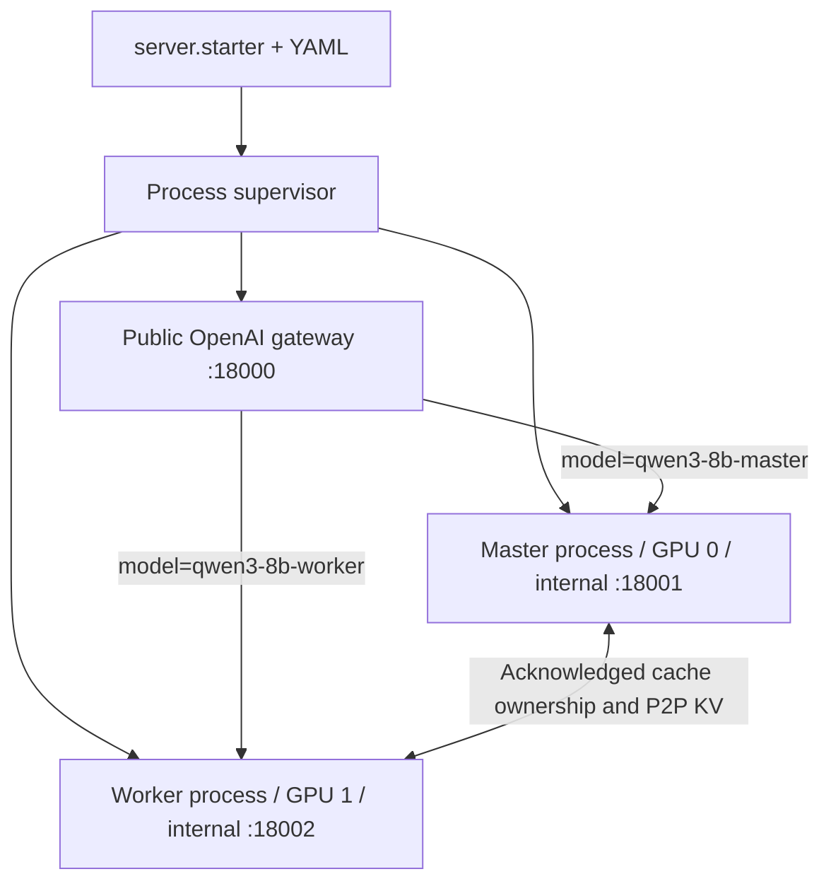

# Unified multi-model serving

Measured results and reproducible benchmarks: [2026-11-08 report](performance-results-2026-11-08.md).

## Start and stop

The canonical entry point is:

```bash
cd /root/hujianmin/SwiftCache
.venv/bin/python -m server.starter --config configs/two_qwen8b.yaml
```

`server/starter.py` is a thin CLI. `server/launcher.py` owns model processes,
readiness, failure propagation, shutdown and run-specific IPC cleanup.
`server/configuration.py` validates configuration. `server/openai_app.py` builds
each model's application; `server/gateway.py` routes public requests by model
name. `server/elastic_server.py` and `server/api_server.py` forward to this same
implementation rather than maintaining independent inference servers.



Change paths, instance names, GPU IDs and engine options in YAML. Relative model
paths resolve against the YAML directory. CLI `--model` overrides all model
paths; `--gpus 0,1` overrides their GPUs. A master and each worker currently need
separate GPUs, TP=1 and eager execution. One master with multiple worker entries
can be described, but this release's GPU validation uses one master and one
worker. The optional [C++ scheduler](cpp-scheduler.md) supports this same control
protocol; select it with `--scheduler-backend cpp` after building the extension.

```bash
.venv/bin/python -m server.starter --config configs/two_qwen8b.yaml --print-config
.venv/bin/python -m server.starter --config configs/two_qwen8b.yaml --host 0.0.0.0 --port 18000
```

The default public listener is `127.0.0.1`. Other hosts can connect when the
configured listener and network permit. Configure `api_key_env` with the name of
a service-specific environment variable to require a Bearer key. The launcher
prints the effective configuration, not the key value. GPU IDs in YAML are
physical visible-device selections; a conflicting `CUDA_VISIBLE_DEVICES` is
rejected.

`/ready` waits for all model applications; `/health` has the same readiness
semantics. Startup is bounded by `startup_timeout`. Inference-loop failure marks
the instance unhealthy and stops its process; the supervisor stops the pair.
SIGINT/SIGTERM shuts down admission and HTTP handlers, then releases child
processes and IPC. The parent bounds shutdown by `shutdown_timeout`.

## CUDA environment

Use a base Python with compatible PyTorch, FlashAttention and Triton already
installed. On the validation server:

```bash
SWIFTCACHE_BASE_PYTHON=/root/miniconda3/envs/nano/bin/python \
  bash scripts/setup_serving_env.sh
.venv/bin/python -m pip install -r requirements-test.txt
```

`requirements-serving.txt` installs serving/client dependencies without replacing
the base CUDA stack. The tested stack is recorded with benchmark artifacts.
The validation machine uses A100 PCIe 40GB GPUs with peer access, without NVLink.

## Official SDK clients

```python
from openai import OpenAI

client = OpenAI(base_url="http://127.0.0.1:18000/v1", api_key="local")
print([m.id for m in client.models.list()])
result = client.chat.completions.create(
    model="qwen3-8b-master",
    messages=[{"role": "user", "content": "What is 2 + 2?"}],
    temperature=0,
    max_completion_tokens=32,
)
print(result.choices[0].message.content)
```

`local` is a placeholder key when authentication is disabled. Calls go to the
configured SwiftCache service, not to OpenAI-hosted models.

```python
import asyncio
from openai import AsyncOpenAI

async def main():
    async with AsyncOpenAI(base_url="http://127.0.0.1:18000/v1", api_key="local") as client:
        stream = await client.chat.completions.create(
            model="qwen3-8b-master",
            messages=[{"role": "user", "content": "用中文介绍缓存。"}],
            max_tokens=64,
            stream=True,
            stream_options={"include_usage": True},
        )
        async for chunk in stream:
            if chunk.choices:
                print(chunk.choices[0].delta.content or "", end="", flush=True)

asyncio.run(main())
```

The command-line client uses this SDK too:

```bash
.venv/bin/python -m server.client --base-url http://127.0.0.1:18000/v1 \
  --model qwen3-8b-master --prompt 'What is 2 + 2?' --stream
```

LangChain `langchain_openai.ChatOpenAI` is validated with this same base URL,
model alias and key, for `invoke` and `stream`; set `use_responses_api=False`.
The same model path can have distinct master/worker aliases to avoid ambiguous
routing and to preserve reproducible prefix-hit tests.

## Compatibility matrix

| Interface / feature | Status |
| --- | --- |
| `GET /v1/models`, `/v1/models/{id}` | Available served aliases |
| `POST /v1/chat/completions` | Text chat, sync/async SDK, nonstream/SSE |
| `POST /v1/completions` | One text prompt or one flat token-ID list; nonstream/SSE |
| Chat roles | system, user, assistant; developer mapped to system |
| Content parts | Text parts only |
| Sampling | temperature and real nucleus top_p |
| Output limits | max_tokens or max_completion_tokens, not both |
| Stopping | EOS, output length and up to four text stop strings |
| Usage | Full prompt, output, total and cached prompt token counts |
| Streaming | Incremental content, stable IDs, finish reason, optional final usage, `[DONE]` |
| Cancellation | Disconnect propagated through gateway; live KV released |
| Errors | OpenAI-shaped errors and non-200 status for invalid/unsupported requests |
| Multiple candidates / best_of / echo | n=1, best_of=1, echo=false |
| Tools, logprobs, seed, penalties, structured output | Not implemented; nondefault requests rejected |
| Responses, multimodal, embeddings, stored completion CRUD | Not implemented |

See the official [Chat Completions request reference](https://developers.openai.com/api/reference/python/resources/chat/subresources/completions/methods/create)
and [streaming events](https://developers.openai.com/api/reference/resources/chat/subresources/completions/streaming-events)
for the protocol shape used by these endpoints. This matrix defines the
implemented subset, not the complete OpenAI product surface.

The stream comes from actual decode steps, not from splitting a completed
answer. Unicode and partial stop strings are buffered. Queues are enabled only
for streaming requests. Nonstream requests do not retain all intermediate text
prefixes. `usage.prompt_tokens` includes cached history; it is not reduced to
only newly computed tokens.

## Length override and cache capacity

```bash
.venv/bin/python -m server.starter --config configs/long_prefix_remote.yaml \
  --max-model-len 131072 --ignore-model-max-length
```

The flag bypasses the model configuration's context cap. It extends the runtime
position cache for the requested length without changing RoPE scaling or model
weights. Without it, the model cap is retained. It does not bypass available KV
capacity, ownership, index bounds or memory limits. Runtime capacity and the
original limit are visible in `/cache`.

`long_prefix_remote.yaml` uses a one-layer master buffer and worker storage;
`long_prefix_local.yaml` provides 412 regular master blocks and lets the worker
keep all eight of its own blocks, making the prefix access local. These are
explicit capacity-capped test configurations, not automatic memory maximizers.
The runtime context limit is 131072, but the actual request capacity can be
smaller; admission uses maximum usable blocks, excluding permanently reserved
worker space. The final sampled token does not itself require another KV slot.

Warmup size is independent of maximum serving context. Prefill batching counts
uncached query tokens, and live shared prefixes are charged only for newly
occupied blocks. The batch-token setting is a batching target: one cold request
larger than the target can execute alone. Chunked prefill is not implemented.
For hard cold-prefill bounds, use an appropriate context/capacity configuration.
Requests above the original model limit establish system execution/timing, not
long-context task accuracy.

## Diagnostics and validation

`/generate` remains for old clients and internal timing benchmarks. Internal
model ports expose `/profiling` to toggle CUDA timing events and
`/request-metrics/{completion_id}` for a bounded 32-entry history. These
diagnostics are separate from OpenAI responses. `/cache` exposes reference and
ownership invariant checks. Do not add cache-debug fields to public SDK bodies.

```bash
CUDA_VISIBLE_DEVICES= .venv/bin/python -m pytest -q tests/test_elastic.py tests/test_serving.py
.venv/bin/python -u tests/validate_openai.py
```

The CPU benchmark imports the real scheduler from an explicit source tree.
Its timings omit GPU execution/transport and JSON/tokenization; input token
integers are independent between requests to avoid artificially cheap identity
comparisons. Detailed `cProfile` captures are separate from primary timing runs.

The real GPU benchmark verifies cached-token counts and actual prefill query
counts for every sample. CUDA model span includes layer dependencies and
communication waits; transfer spans may overlap computation and each other, so
they must not be added to infer total latency. API streaming tests separately
measure first content and full-text preprocessing.
