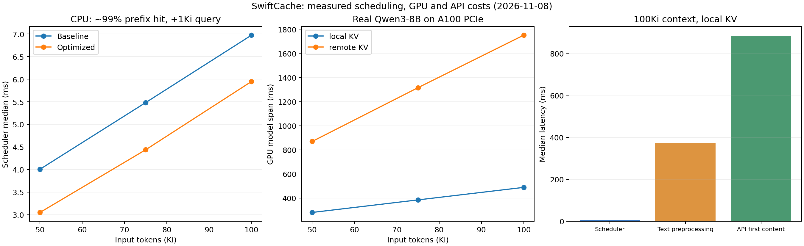

# SwiftCache 统一服务与长前缀调度测试结果

日期：2026-11-08。服务器：Cloud-A100-233。工作目录：`/root/hujianmin/SwiftCache`。
基线：`16815fcdd8d87e71bb4099dda6d46f65f1a286a2`；分支：`codex/openai-serving-long-prefix`。

## 1. 已实现的服务能力

统一入口为 `python -m server.starter --config configs/two_qwen8b.yaml`。
`starter.py` 只解析 CLI，`configuration.py` 校验 YAML，`launcher.py` 管理进程、就绪、故障和退出，
`openai_app.py` 负责模型实例的协议转换，`gateway.py` 在同一个公共地址按模型别名路由。
旧 `elastic_server.py`、`api_server.py` 共用此实现。默认公共端口 18000，模型内部端口 18001/18002。

已交付 `/v1/models`、文本 Chat Completions、文本 Completions、真正逐步生成的 SSE、
`stop`、`temperature`、真实 `top_p`、usage/cached_tokens、错误对象、取消及 KV 释放。
官方 `OpenAI`/`AsyncOpenAI` SDK 和 `langchain_openai.ChatOpenAI` 通过 `base_url`、key、model 接入。
工具调用、Responses、多模态、结构化输出等不在本次支持范围；完整矩阵和调用示例见 [接入文档](openai-serving.md)。

显式参数 `--ignore-model-max-length` 已实现；对应 YAML 为 `ignore_model_max_length: true`。
未开启时保留模型原始上限。开启后扩展位置缓存，不改变模型权重或 RoPE scaling，仍执行实际 KV 容量检查。
100K 结果用于验证系统执行和计时，不代表 Qwen3-8B 超出原始 40960 上下文的任务准确率。

## 2. 环境与实验边界

- 只使用 GPU 0、1：两张 A100 PCIe 40GB，各运行一个完整 Qwen3-8B，BF16、TP=1、eager。
- GPU 间可 P2P 访问，无 NVLink；CPU 为双路 Xeon Gold 6230R，共 104 逻辑线程。
- Python 3.11.15、Torch 2.6.0+cu124、FlashAttention 2.8.3、Triton 3.2.0、Transformers 4.51.0。
- OpenAI SDK 3.46.0、LangChain OpenAI 1.7.4；请求发送到本机 SwiftCache，无需 OpenAI 云端密钥。
- `OMP_NUM_THREADS=4`、`OPENBLAS_NUM_THREADS=4`；共享服务器，未做 CPU 绑核和机器独占，尾部延迟包含系统噪声。
- GPU 长前缀组显式运行上限 131072，KV block=256。远端组 master 仅 LSC 工作区，worker 448 blocks、固定保留 1；
  本地组 master 412 个常规 blocks，worker 固定保留自身全部 8 blocks，实测 KV 加载/写回到远端均为 0。
- 先实际建立 P，再提交 P+U，每次改变 U 的首 token。每个样本校验命中数、实际 query token 数及有限 logits。
  建立更长 P 时逐段预热历史；实现没有 chunked prefill，不能据此宣称一次性冷启动 100K 的显存峰值已优化。

完整版本、配置 SHA256、模型 config SHA256 和拓扑保存在服务器 `artifacts/phase2/environment.json`。

## 3. CPU scheduler：优化前后

以下测量真实 Python `Scheduler`、`BlockManager`、前缀哈希、内容比较和块分配，隔离 GPU/传输。
输入为预先生成的 token IDs，不包含 JSON、分词。每个请求重新创建独立整数对象，避免复用同一对象导致列表比较虚快。
每配置 100 次预热、1000 次测量、重复 5 轮；表内为“五轮各自 p50 的中位数”。池规模 512 blocks。

| 总输入 | 前缀命中 | 重新计算 | 基线 schedule | 优化后 schedule | 降低 | 优化后 p95* |
| ---: | ---: | ---: | ---: | ---: | ---: | ---: |
| 51,200 | 50,176 | 1,024 | 4.005 ms | 3.048 ms | 23.9% | 3.875 ms |
| 76,800 | 75,776 | 1,024 | 5.482 ms | 4.437 ms | 19.1% | 5.810 ms |
| 102,400 | 101,376 | 1,024 | 6.974 ms | 5.948 ms | 14.7% | 8.000 ms |

\* p95 同样取五轮各自 p95 的中位数。原始数组保留在 `cpu-*-core.json`；不以少量请求估计稳定 p99。
100K 的前缀匹配及分配约 5.139 ms，Sequence 构建约 0.211 ms，postprocess 约 0.630 ms；后两项不计入 schedule。
墙钟和线程 CPU 时间均采集，固定容量下两者接近；CPU 空控制通道不代表真实扩缩容等待时间。

优化包括：同一次入场检查与分配复用前缀计划；空闲命中块直接增加引用；延迟重建空闲堆；
按新增 query token 计批预算；容量判断按实际新占用块计数。
测试中两个 100K 请求共享 396 个活跃前缀块，仅新增 4 块时，旧版拒绝第二个请求，新版正确准入，总占用 404 块。

另测大元数据池（100K/+1K，200 次测量×3 轮）：8192 blocks 从 20.481 降为 9.213 ms；
32768 blocks 从 71.856 降为 23.594 ms。这是 CPU 元数据规模实验，**不代表两张 40GB GPU 实际存放了该规模 KV**。
单独 cProfile 的 100 个请求中，heapify 从 400 次减为 100 次，哈希仍为 40000 次。
因此优化没有把匹配变成 O(新增 token)：完整历史的逐块转换、哈希和内容验证仍随上下文增长。
cProfile 数据带额外开销，未用于上表主计时。

补充非对齐输入 50000 token，实际命中 48896、新增 1104：4.408 → 3.020 ms；
100K 输入、仅命中 51200 的部分命中组：35.909 → 6.792 ms（200 次×3 轮）。
后者有更多待分配块，延迟重建堆的收益更明显。

真实 waiting 队列探测（每请求 100K/+1K，5 次预热、20 次测量）：

| waiting 请求数 | 基线首次准入数 | 优化后首次准入数 | 优化后首次 schedule p50 |
| ---: | ---: | ---: | ---: |
| 1 | 1 | 1 | 6.815 ms |
| 2 | 1 | 2 | 13.749 ms |
| 4 | 1 | 4 | 26.908 ms |
| 8 | 1 | 8 | 59.440 ms |
| 32 | 1 | 8 | 85.461 ms |

一次 schedule 可以扫描并分配多个请求，因此单请求约 6 ms 不等于批处理也只需 6 ms。
新版修正共享活跃块准入后，同一次调用处理的请求数增加，表内首次调用不能直接与旧版的一请求调用比较速度。
排队组为 CPU 元数据实验，剩余请求逐批完成并检查引用不变量；这不是 GPU batch=8 的实测吞吐。

## 4. 双卡真实模型：相同 +1024 query

每个长度、每种放置预热 10 次/轮，测量 30 次/轮，共 3 轮、90 个有效样本；下表 p50 合并这 90 个样本。
为获取内部指标，此表走模型内部 `/generate`，输入 token IDs；**不包含完整文本分词，不能当作完整文本 API TTFT**。
max_tokens=1，客户端延迟包含请求、入队、一次模型执行和响应。

| 输入 | 本地 KV：schedule | 本地 GPU span | 本地客户端 | 远端 KV：schedule | 远端 GPU span | 远端客户端 |
| ---: | ---: | ---: | ---: | ---: | ---: | ---: |
| 51,200 | 3.081 ms | 281.017 ms | 306.440 ms | 3.286 ms | 869.729 ms | 896.852 ms |
| 76,800 | 4.398 ms | 385.030 ms | 421.506 ms | 4.555 ms | 1315.299 ms | 1353.622 ms |
| 102,400 | 5.712 ms | 488.775 ms | 533.440 ms | 5.904 ms | 1750.621 ms | 1796.923 ms |

100K 时，本地/远端 schedule p95 分别 7.440/8.186 ms，GPU span p95 为 491.246/1764.338 ms。
schedule 中位数相当于 GPU span 的约 1.17%/0.34%。
CUDA span 是模型阶段的时间跨度，包含层依赖、传输等待及其间的主机提交间隙，**不是纯算子计算时间**。
逐层 KV 传输 span 的和可能与计算、其他传输重叠，不能把它们相加当作总耗时或直接相减推导纯 attention 时间。

固定缓存 101376 token，新增长度诊断（各 5 次预热、10 次测量，中位数）：

| 新增 query | 本地 schedule | 本地 GPU span | 远端 schedule | 远端 GPU span |
| ---: | ---: | ---: | ---: | ---: |
| 1 | 5.303 ms | 48.760 ms | 5.793 ms | 1426.119 ms |
| 256 | 5.502 ms | 162.573 ms | 5.757 ms | 1524.959 ms |
| 4096 | 5.905 ms | 1858.498 ms | 6.163 ms | 2829.299 ms |

这说明极短新增、本地 KV 时，CPU 匹配的相对占比会上升；远端模式即使只新增 1 token，也需访问历史 KV。
不能把“只重算 1K”理解为 GPU 耗时只由这 1K 决定。

开启/关闭 CUDA 埋点各顺序测 10 次：本地客户端 p50 534.253/535.296 ms（关闭/开启），
远端关闭与开启也有运行间波动。样本小且顺序未随机化，只能说明此轮未观察到明显量级变化，不能据此断言精确埋点开销或开启后更快。

## 5. 完整 OpenAI 文本 API

通过公共 gateway、真实 Chat Completions 和 SSE，记录首次**非空内容**到达，不把 role chunk 当首 token。
文本实际经聊天模板和 tokenizer 后为 102301 token，命中 101376，新增 925；与上表的精确 +1024 输入分开报告。
每种放置预热 10 次，测量 30 次，max_tokens=1。

| 放置 | 服务端模板+分词 p50 | 首内容 p50 | 首内容 p95 | 完整返回 p50 |
| --- | ---: | ---: | ---: | ---: |
| 本地 KV | 373.987 ms | 884.031 ms | 1037.668 ms | 884.592 ms |
| 远端 KV | 394.112 ms | 2185.156 ms | 2227.935 ms | 2185.875 ms |

客户端为验证 token 数而额外执行的 tokenizer 检查在请求计时之外，原始数据单列，不叠加进 TTFT。
KV 前缀命中并不省去服务端对完整输入文本的模板处理和分词；这部分 CPU 开销明显高于 schedule。

负载测试还暴露并修复了一处协议层热点：校验预分词输入时逐 token 调用 `len(tokenizer)`。
当前 fast tokenizer 的该操作会处理完整词表，100K 输入曾长时间阻塞 API 事件循环；已改为每请求只查询一次，增加独立回归。
所有到达率结果均为修复后重新运行。

## 6. 并发与到达率

共享 100K 前缀的闭环并发 1/2/4，分别测 5/10/20 个请求：

| 放置 | 提交并发 1 吞吐 | 提交并发 2 吞吐 | 提交并发 4 吞吐 | 并发 4 延迟 p50 |
| --- | ---: | ---: | ---: | ---: |
| 本地 KV | 1.894 req/s | 1.886 req/s | 1.954 req/s | 2011.002 ms |
| 远端 KV | 0.559 req/s | 0.606 req/s | 0.917 req/s | 4315.579 ms |

提交并发 4 不等于始终 batch=4：实测经常是先 1、再 3。实际 batch 大小保存在原始 JSON。
当前模型进程中的 GPU step 同步执行，会阻塞该进程的 HTTP 接收/处理；文本分词也在此事件循环执行。
因此不能从一个 schedule 调用较短推断整个 Python 服务吞吐没有瓶颈。后续应优先考虑接收、分词与模型执行解耦，以及远端传输优化。

公共 OpenAI Completions 预分词输入到达率探测：每组 12 个请求，固定 Poisson 种子 20261108，
每请求实际输入 102400、命中 101376、新增 1024。下表仅为小样本排队观察，无稳定 p99/SLO 或最大吞吐承诺。

| 放置 | 配置到达率 | 实际到达率 | 完成吞吐* | 客户端延迟 p50 | 最大延迟 |
| --- | ---: | ---: | ---: | ---: | ---: |
| 本地 | 1 req/s | 0.912 | 0.912 req/s | 764.274 ms | 1303.098 ms |
| 本地 | 2 req/s | 1.823 | 1.414 req/s | 2176.314 ms | 3785.275 ms |
| 本地 | 4 req/s | 3.646 | 1.686 req/s | 2772.763 ms | 4899.848 ms |
| 远端 | 0.25 req/s | 0.228 | 0.232 req/s | 1991.382 ms | 3469.134 ms |
| 远端 | 0.5 req/s | 0.456 | 0.432 req/s | 3243.381 ms | 5959.621 ms |
| 远端 | 1 req/s | 0.912 | 0.729 req/s | 4290.661 ms | 7015.905 ms |

\* 完成数除以从第一个提交到最后一个完成的时间，含末尾排空，不是稳定状态容量。

## 7. 如何理解结论

在本次两张 A100、Qwen3-8B、约 99% 前缀命中、+1024 query 的已测配置中，
Python scheduler 的耗时随上下文增长到约 6 ms，但没有超过 GPU 阶段成为主要瓶颈。
跨卡历史 KV 访问和完整文本 API 前处理更值得优先优化。
若新增仅 1 token、本地 KV、GPU 更快，或元数据池扩大，调度占比会上升；不能将此结论外推到所有硬件和负载。

测试已覆盖本地和远端两个端点对照、共享前缀并发、CPU 冷/部分/接近全命中、非对齐输入及扩缩容正确性。
未对每一个可组合维度做 GPU 全排列：混合缓存比例、独立 100K 前缀多请求同时驻留、长时间稳定负载以及超原始窗口任务准确率均不在本次实测结论范围。

最终回归：18 项 pytest 通过；官方 SDK 同步/异步、双模型路由、中文流式与非流式一致、跨 chunk stop、
多轮对话、usage、错误、取消与 LangChain invoke/stream 均通过。
双卡实际运行 12 轮扩缩容，最终累计 56 次 worker resize_applied，包含 3 次活跃块回收事件；
跨 256-token 块边界解码、worker 全 32 块占用及排队 master 恢复通过（排队恢复约 3.213 s）。
8 组基线和 3 组边界输出均与上一阶段保存的 HF 参考逐 token 一致，共 11 组；本阶段没有重新执行 HF 模型参考。
结束后无活跃 KV、无 pending/draining；已停止测试服务，GPU 0/1 均恢复至 4 MiB、0% 利用率。
详见 [回归汇总](benchmarks/validation-summary.json)。



## 8. 复现与证据

```bash
cd /root/hujianmin/SwiftCache
export OMP_NUM_THREADS=4 OPENBLAS_NUM_THREADS=4
.venv/bin/python -m pytest -q tests/test_elastic.py tests/test_serving.py
.venv/bin/python -m server.starter --config configs/two_qwen8b.yaml
# 另一个终端，普通接口及扩缩容回归
.venv/bin/python tests/validate_openai.py
mkdir -p artifacts/phase2/regression
cp artifacts/fixed-results.json artifacts/phase2/regression/fixed-results.json
.venv/bin/python tests/validate_serving.py elastic --cycles 12 --port 18001 --artifacts artifacts/phase2/regression
.venv/bin/python tests/validate_boundaries.py --port 18001 --artifacts artifacts/phase2/regression
```

结束普通服务后再启动长前缀配置；本地和远端应分开运行，避免占用相同 GPU/端口。

```bash
.venv/bin/python -m server.starter --config configs/long_prefix_remote.yaml
# 另一个终端；本地对照将两处 remote 改成 local
.venv/bin/python tests/bench_long_prefix.py --placement remote --output artifacts/phase2/gpu-remote.json
.venv/bin/python tests/bench_suffix_sizes.py --placement remote --output artifacts/phase2/gpu-remote-suffix.json
.venv/bin/python tests/bench_openai_long.py --output artifacts/phase2/openai-remote-long.json
.venv/bin/python tests/bench_arrivals.py --placement remote --rates 0.25 0.5 1 --output artifacts/phase2/arrivals-remote.json
# 本地到达率使用 --rates 1 2 4
```

CPU 基线与当前版用同一驱动、不同源码树：

```bash
mkdir -p artifacts/phase2/baseline-src
git archive 16815fc | tar -x -C artifacts/phase2/baseline-src
.venv/bin/python tests/bench_scheduler.py --source artifacts/phase2/baseline-src --suite core --output artifacts/phase2/cpu-baseline-core.json
.venv/bin/python tests/bench_scheduler.py --source . --suite core --output artifacts/phase2/cpu-final-core.json
# 可选 --suite diagnostic / edge / supplemental；profile 需单独运行：
.venv/bin/python tests/bench_scheduler.py --source . --suite profile --profile-output artifacts/phase2/cpu-final.pstats --output artifacts/phase2/cpu-final-profile-summary.json
# 汇总和绘图；绘图需要 matplotlib，原始 JSON 不依赖它
.venv/bin/python tests/summarize_benchmarks.py --input artifacts/phase2 --output docs/benchmarks
```

原始数据与日志在服务器 `artifacts/phase2/`。仓库保存小体积 [汇总 JSON](benchmarks/metrics-summary.json) 和图表；
完整原始 JSON、日志、cProfile、环境快照另行打包，保留基线和源码补丁，便于复核。
